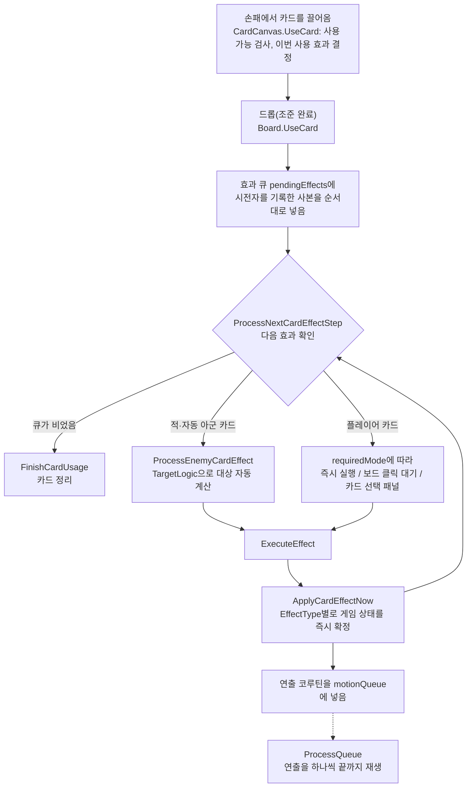

# 카드 사용·효과 처리 구조

ChessRogueLike의 카드 전투는 "카드를 쓰면 무엇이, 어떤 순서로 일어나는지"를 플레이어가 미리 알 수 있어야 한다는 전제로 설계했다. 이 문서는 그 구조를 설명하고, 구조가 실제 코드와 커밋 이력에서 지켜지고 있다는 근거를 정리한다.

- 기준 커밋: `4595426` (2026-10-21)
- 코드 링크의 줄 번호는 기준 커밋 기준이다.

## 1. 요약

- **세 계층 분리**: 카드(`Card`), 효과 데이터(`CardEffect`), 효과 처리(`Board`)를 나눴다.
- **순서 보장**: 카드 한 장의 효과는 **효과 큐**(`pendingEffects`)에서 등록한 순서대로 하나씩 처리된다. 연출은 **연출 큐**(`motionQueue`)에 같은 순서로 쌓이고, 앞 연출이 끝나야 다음 연출이 재생된다.
- **단일 실행 함수**: 플레이어 카드, 적·자동 아군 AI, 유물, 턴 지속 효과, 처치 시·소환 시 효과가 모두 `Board.ApplyCardEffectNow` 하나로 실행된다.
- **카드는 데이터 조합**: 카드 클래스 94개 중 자기만의 실행 로직을 가진 카드는 0개다. 모든 카드가 `CardEffect` 필드를 조합해서 만들어진다.

## 2. 세 계층

| 계층 | 타입 | 맡는 일 | 맡지 않는 일 |
|---|---|---|---|
| 카드 | `Card` (MonoBehaviour) — [Card.cs:67](../Assets/Scripts/Card.cs#L67) | 이름·코스트·종류, 드래그 대상, 사용 조건, 설명 텍스트, 효과 목록(`effects`) 보관 | 효과 실행 |
| 효과 데이터 | `CardEffect` (불변 `record`, 필드 45개) — [Card.cs:596](../Assets/Scripts/Card.cs#L596) | 효과 하나의 "무엇을, 누구에게, 얼마나": 종류(`EffectType` 30종), 수치, 범위, 대상 규칙, 상태 효과, 연쇄 효과 | 실행 |
| 효과 처리 | `Board` (partial class) — [Board.CardEffect.cs](../Assets/Scripts/Board.CardEffect.cs) | 큐 진행, 대상 결정, `EffectType`별 상태 변경, 연출 예약 | 카드별 분기 |

`CardEffect`는 `record` + `init` 프로퍼티라 만든 뒤에는 바뀌지 않는다. 실행할 때 필요한 정보(시전자 등)는 `effect with { caster = piece }`로 사본을 만들어 붙인다. 턴 지속 효과가 카드의 효과 객체를 공유하기 때문에, 원본을 고치면 다른 곳까지 값이 바뀐다.

## 3. 카드 한 장이 처리되는 흐름



1. **사용 확정** — `Board.UseCard` [Board.CardEffect.cs:28-45](../Assets/Scripts/Board.CardEffect.cs#L28-L45): 이전 카드 상태를 초기화하고, `card.UseEffects`를 `effect with { caster = currentCardCaster }` 사본으로 효과 큐에 채운다.
2. **큐 진행** — `ProcessNextCardEffectStep` [Board.CardEffect.cs:79-198](../Assets/Scripts/Board.CardEffect.cs#L79-L198): 다음 효과를 보고 진행 방식을 고른다. 시전자가 죽었으면 건너뛰고, 엔진이 끼워 넣은 효과(`executeOnCaster`)는 바로 실행하고, 무덤 비용이 부족하면 건너뛴다. 적 카드는 자동으로 대상을 정하고, 아군 카드는 `requiredMode`에 맞는 입력을 기다린다.
3. **실행** — `ExecuteEffect` [Board.CardEffect.cs:513-536](../Assets/Scripts/Board.CardEffect.cs#L513-L536): 카드의 첫 효과일 때만 사용을 확정한다(`MarkCardEffectStarted` [539-558](../Assets/Scripts/Board.CardEffect.cs#L539-L558) — "카드 사용 시" 유물 발동, 에너지 차감, 이후 취소 불가). 이어서 대상이 사라졌는지 확인하고, 무덤을 지불한 뒤 `ApplyCardEffectNow`를 부른다.
4. **적용** — `ApplyCardEffectNow` [Board.CardEffect.cs:591-833](../Assets/Scripts/Board.CardEffect.cs#L591-L833): 범위형 대상 규칙이면 `ExecuteAreaEffect`로, 아니면 `EffectType` switch로 분기한다. 게임 상태는 여기서 바로 바뀌고, 연출만 `motionQueue`에 들어간다.
5. **종료** — `FinishCardUsage` [Board.CardEffect.cs:1224-1240](../Assets/Scripts/Board.CardEffect.cs#L1224-L1240).

### 순서를 보장하는 두 개의 FIFO 큐

| 큐 | 담는 것 | 다음 항목으로 넘어가는 조건 |
|---|---|---|
| `pendingEffects` (`Queue<CardEffect>`) — [Board.CardEffect.cs:7](../Assets/Scripts/Board.CardEffect.cs#L7) | 처리할 효과 데이터 | 앞 효과의 **로직**이 끝나면 바로 |
| `motionQueue` (`Queue<IEnumerator>`) — [Board.Animation.cs:8](../Assets/Scripts/Board.Animation.cs#L8) | 연출 코루틴 | 앞 **연출**이 끝나야 (`ProcessQueue`의 `yield return StartCoroutine` — [Board.Animation.cs:29-43](../Assets/Scripts/Board.Animation.cs#L29-L43)) |

게임 상태(칸 점유, 체력, 손패 소속)는 효과 큐에서 동기적으로 확정되고, 연출은 같은 순서로 연출 큐에 쌓였다가 나중에 재생된다. 그 결과는 다음과 같다.

- 효과 2는 효과 1의 결과(이동한 위치, 죽은 대상, 버린 카드 수)를 항상 정확하게 본다.
- 화면에는 효과 1의 연출이 끝난 뒤에 효과 2의 연출이 나온다.
- 연출이 재생되는 동안에도 다음 카드를 쓸 수 있다(카드 예약). 다음 카드의 로직은 이미 확정된 상태를 기준으로 처리되기 때문이다.

연출 코루틴은 재생 시점에 칸을 다시 조회하지 않고, 큐에 넣을 때 대상 기물을 파라미터로 받는다(`PieceMoveCor` — [Board.Animation.cs:68](../Assets/Scripts/Board.Animation.cs#L68)). 연출을 기다리는 동안 그 칸이 이미 비었을 수 있기 때문이다.

**재진입 가드** — `ProcessNextCardEffect` [Board.CardEffect.cs:55-77](../Assets/Scripts/Board.CardEffect.cs#L55-L77): 바로 실행되는 효과가 같은 호출 스택 안에서 큐 진행을 다시 부를 수 있다. 그래서 처리 중일 때 들어온 호출은 "한 번 더 돌 것"만 표시하고 돌아가고, 바깥 루프가 이어서 처리한다. 재귀가 깊어지거나, 바깥 호출이 쓰던 선택 상태를 안쪽 호출이 먼저 지우는 문제를 막는다.

## 4. 카드 없이 발동하는 효과도 같은 함수로 처리

| 발동 경로 | 효과 데이터 | 진입점 | 실행 |
|---|---|---|---|
| 플레이어 카드 | `Card.effects` | `Board.UseCard` | 효과 큐 → `ApplyCardEffectNow` |
| 적·자동 아군 AI | `AutoPiece.actionCards` (이것도 `Card` 컴포넌트) | `PlayEnemyTurnCoroutine` → `Board.UseCard` ([Board.TurnControl.cs:86](../Assets/Scripts/Board.TurnControl.cs#L86)) | 위와 같음 |
| 기절한 적 | `StunnedCard` | 위와 같음 | 위와 같음 |
| 처치 시 효과 | `CardEffect.onKillEffect` | `TriggerOnKillEffect` ([Board.Combat.cs:324](../Assets/Scripts/Board.Combat.cs#L324)) — 효과 큐 맨 앞에 `executeOnCaster` 사본을 넣음 | 위와 같음 |
| 소환 시 효과 | `Piece.onSpawnCards` | `ApplySpawnOccupancy` ([Board.Occupancy.cs:15](../Assets/Scripts/Board.Occupancy.cs#L15)) — 효과 큐에 넣음 | 위와 같음 |
| 기물 선택 효과 | `CardEffect.pieceSelectCount` | `ApplyPieceSelectionEffect` ([Board.CardEffect.cs:1280](../Assets/Scripts/Board.CardEffect.cs#L1280)) — 고른 기물마다 사본을 넣음 | 위와 같음 |
| 유물 | `Relic.Effects` (`List<CardEffect>`) | `DrainRelicQueue` ([Board.Relics.cs:105](../Assets/Scripts/Board.Relics.cs#L105)). 전투 시작 유물은 효과 큐에 넣음([Board.Relics.cs:49](../Assets/Scripts/Board.Relics.cs#L49)) | `ApplyCardEffectNow` |
| 턴 지속 효과 | `TurnEffect.cardEffect` | `ExecutePieceTurnEffects` → `EnqueueScheduledEffect` ([Board.TurnEffects.cs:27](../Assets/Scripts/Board.TurnEffects.cs#L27)) | `ApplyCardEffectNow` |

`ApplyCardEffectNow`는 "지금 쓰는 카드"의 상태(`currentActiveCard`, `pendingEffects`, `effectApplied`)를 건드리지 않는다. 그래서 카드를 처리하는 도중에 유물이나 턴 효과가 끼어들어도 진행 중인 카드가 깨지지 않는다([Board.ScheduledEffects.cs](../Assets/Scripts/Board.ScheduledEffects.cs)).

> **예외**: 독·화상·재생의 턴 종료 피해·회복은 같은 종류를 합쳐 한 번에 적용하려고 `Piece.ProcessStatusEffects`([Piece.cs:135](../Assets/Scripts/Piece.cs#L135))가 직접 처리한다. 이 상태 효과를 **거는** 일은 `CardEffect`(`ApplyStatus`)를 거친다.

## 5. 같은 종류의 효과는 같은 처리

- **피해·방어막 수치**: 모든 `Damage`는 `ResolveDamageWithColDamage`, 모든 `Shield`는 `ResolveShieldWithBonus` 하나로 시전자의 힘·방어막 보너스를 더한다([Board.CardEffect.cs:466-482](../Assets/Scripts/Board.CardEffect.cs#L466-L482)). 카드 설명의 수치 미리보기(`Card.EffectiveDmg`)도 같은 규칙을 쓴다.
- **이동공격**: 이동하다 적에게 부딪히는 경우(`Move`)와 제자리에서 이동공격으로 판정해 때리는 경우(`Damage` + `countsAsMoveAttack`) 모두 `ResolveMoveAttackHit`([Board.Combat.cs:87](../Assets/Scripts/Board.Combat.cs#L87)) 하나를 거친다. 다음 이동공격 버프 소모, 스플래시, 연쇄, 가시 반격이 두 경우에 똑같이 적용된다.
- **범위 효과**: `AllEnemiesInRange` / `AllAlliesInRange` / `AllPiecesInRange`는 효과 종류와 상관없이 `ExecuteAreaEffect`([Board.CardEffect.cs:1086](../Assets/Scripts/Board.CardEffect.cs#L1086))에서 대상을 모은 뒤 종류별로 처리한다.
- **AI 대상 선택**: `TargetLogic`(`NearestEnemy`, `LowestHP` 등)과 도발 우선 규칙(`PrioritizeTauntTargets`)을 적과 자동 아군이 함께 쓴다.

## 6. 카드는 효과 데이터의 조합

예시 — 3연타 후 같은 대상에게 취약을 거는 카드([MagicVulnerableAttackCard.cs](../Assets/Scripts/Cards/MagicVulnerableAttackCard.cs)):

```csharp
effects.Add(new CardEffect
{
    requiredMode = Board.BoardMode.targeting,
    type = EffectType.Damage,
    dmg = 2,
    hitCount = 3,
    targetlogic = TargetLogic.LowestHP,
    effectRange = effectRange[0],
    animTrigger = "Attack",
    ignoreCasterColDamageBonus = true,
});
effects.Add(new CardEffect
{
    requiredMode = Board.BoardMode.targeting,
    type = EffectType.ApplyStatus,
    targetlogic = TargetLogic.LowestHP,
    effectRange = effectRange[0],
    statusEffectType = StatusEffectType.Vulnerable,
    statusDuration = 2,
    statusPower = 2,
    useLastTarget = true,    // 타격한 대상에게 그대로 — 다시 클릭하지 않음
    skipIfTargetGone = true, // 타격으로 대상이 죽었으면 취약은 건너뜀
    animTrigger = "ApplyStatus",
});
```

"같은 대상에게 이어서", "대상이 죽었으면 건너뜀", "3연타" 같은 규칙이 카드 코드가 아니라 `CardEffect` 필드(`useLastTarget`, `skipIfTargetGone`, `hitCount`)로 표현된다. 한 번 만든 필드는 다른 카드에서도 그대로 쓸 수 있다.

**카드 코드 통계** (`Assets/Scripts/Cards/*.cs`):

- 카드 클래스 94개, 총 2,834줄(평균 약 30줄)
- 94개 모두 `Awake()`(효과 조합)와 `EffectDescription`(설명)만 오버라이드한다. 그 밖의 오버라이드는 희귀도 6개, 소멸 조건 1개(`WarmUpDamageCard`), 사용 불가 표시 1개(`WoundCard`)뿐이다.
- 실행 로직을 직접 가진 카드(`Execute` 오버라이드): **0개**

새 카드를 추가할 때 효과 처리 코드는 건드리지 않는다. 절차는 [CLAUDE.md](../CLAUDE.md)의 "카드 추가 절차"에 있다: 효과를 조합한 스크립트 작성 → Tools > Cards > Card Prefab Generator([CardPrefabGenerator.cs](../Assets/Editor/CardPrefabGenerator.cs))로 프리팹 생성·등록 → `effectRange` 지정 → 직업 보상 풀이나 기본 덱에 추가.

## 7. 새 종류의 효과를 기존 흐름에 넣은 사례: 기절 카드

**요구사항**: 기절한 적은 이번 턴에 행동하지 못하고, 기절이 풀리면 원래 예고했던 행동을 이어서 한다.

**도입 전**: 턴 루프에 기절 전용 예외 분기가 있었다(커밋 `d99400a` 이전 `Board.TurnControl.cs`).

```csharp
if (card != null && !enemy.IsStunned())
{
    UseCard(card);
    yield return new WaitUntil(() => pendingEffects.Count == 0 && !queuecoroutineworking);
    enemy.ChangeMove();
    enemy.ActionText();
}
else if (enemy.IsStunned())
{
    enemy.ActionText();
}
```

**설계**: 기절을 "행동하지 않는 예외"가 아니라 "기절 카드를 쓰는 평범한 행동"으로 바꿨다.

1. 기절 중이면 `AutoPiece.GetNextMove()`가 원래 카드 대신 `StunnedCard`를 돌려준다([AutoPiece.cs:50](../Assets/Scripts/AutoPiece.cs#L50)).
2. 기절 중에는 행동 순번(`Movenum`)을 넘기지 않는다. 그래서 기절이 풀리면 원래 카드가 이어진다.
3. `StunnedCard`([StunnedCard.cs](../Assets/Scripts/Cards/StunnedCard.cs))의 효과는 `EffectType.Stun` 하나뿐이다. 게임 상태는 바꾸지 않고 기절 연출과 사운드만 연출 큐에 넣는다([Board.CardEffect.cs:756-765](../Assets/Scripts/Board.CardEffect.cs#L756-L765)).

**도입 후** ([Board.TurnControl.cs:82-91](../Assets/Scripts/Board.TurnControl.cs#L82-L91)):

```csharp
Card card = enemy.GetNextMove();   // 기절 중이면 StunnedCard
if (card != null)
{
    UseCard(card);
    yield return new WaitUntil(() => pendingEffects.Count == 0 && !queuecoroutineworking);
    if (!enemy.IsStunned())
        enemy.ChangeMove();
    enemy.ActionText();
}
```

**결과** (커밋 `d99400a` 기준): 효과 큐 처리 코드(`ProcessNextCardEffect`)는 한 줄도 고치지 않았고, `ApplyCardEffectNow`에는 `case EffectType.Stun:` 분기 하나만 추가했다. 턴 루프에서는 예외 분기가 오히려 사라졌다. 기절한 적도 행동 예고 아이콘, 연출 순서, 다음 적으로 넘어가는 대기 조건까지 일반 행동과 같은 경로를 탄다. 자동 아군(`PlayAutoAllyTurnCoroutine`)도 같은 코드로 기절을 처리한다.

## 8. 구조가 바뀌어 온 과정 (git 이력)

| 날짜 | 커밋 | 변화 |
|---|---|---|
| 2026-03-18 | `e61c2ff` | 효과 큐 `pendingEffects` 도입 |
| 2026-05-10 | `355386a` | `ScheduleNextCardEffect` 도입 — 앞 효과의 연출이 끝날 때까지 기다린 뒤 다음 효과를 처리 |
| 2026-07-19 | `d40928e` | 처치 시 효과(`onKillEffect`) 추가 |
| 2026-08-25 | `8b9d799` | `CardEffect`를 불변 `record`로 전환 |
| 2026-08-25 | `6f0ddd4` | 유물 도입 — 유물·턴 효과가 `ApplyCardEffectNow`를 재사용(`DrainRelicQueue`, `EnqueueScheduledEffect`) |
| 2026-08-26 | `d99400a` | 기절 카드(`StunnedCard`) 도입 |
| 2026-09-14 | `fe9ff26` | 로직과 연출 분리 — 상태는 즉시 확정하고 연출은 `motionQueue`로. 연출 중에도 다음 카드 사용 가능(카드 예약) |
| 2026-10-01 | `e29909a` | 효과마다 시전자(`caster`) 기록 — 앞 효과로 이동했으면 다음 효과는 새 위치 기준 |
| 2026-10-02 | `d8616df` | `CLAUDE.md` 작성 — 이 구조를 AI 작업 규칙으로 정리 |
| 2026-10-17 | `94152c5` | 처치 시 효과와 기물 선택 효과도 효과 큐로 통합(`executeOnCaster`) |

`355386a`에서 `fe9ff26`으로 넘어가며 "연출이 끝날 때까지 기다린 뒤 다음 효과 처리"가 "로직은 바로, 연출은 순서대로"로 바뀌었다. 효과 순서는 그대로 보장하면서 연출 대기만 없앴다.

### 카드 수와 효과 종류의 증가

| 시점 | 카드 클래스 | `EffectType` |
|---|---|---|
| 2026-03-19 | 2 | 4 |
| 2026-05-22 | 25 | 14 |
| 2026-06-28 | 35 | 19 |
| 2026-08-26 | 52 | 26 |
| 2026-09-29 | 59 | 29 |
| 2026-10-01 | 66 | 30 |
| 2026-10-06 | 82 | 30 |
| 2026-10-17 (현재) | 94 | 30 |

2026-10-01 이후 카드 클래스가 28개 늘어나는 동안 `EffectType`은 하나도 늘지 않았다. 이 기간의 새 카드는 모두 기존 효과 데이터를 조합해 만들었다.

## 9. 현재 수치 (기준 커밋 `4595426`)

| 항목 | 수 | 근거 |
|---|---|---|
| 게임에 등장하는 카드 | 89종 | 플레이어 카드 62(`Database.prefab`의 `cardPrefabs`) + 적·자동 아군 행동 카드 26(기물 프리팹에 부착) + 기절 카드 1(런타임에 부착) |
| 카드 클래스 | 94개 | `Assets/Scripts/Cards/*.cs` (어디에도 쓰이지 않는 5개 포함) |
| 효과 종류 `EffectType` | 30종 | [Card.cs:595](../Assets/Scripts/Card.cs#L595) |
| 상태 효과 `StatusEffectType` | 19종 | [Enum.cs](../Assets/Scripts/Enum.cs) |
| `CardEffect` 필드 | 45개 | [Card.cs:596-706](../Assets/Scripts/Card.cs#L596-L706) |
| `ApplyCardEffectNow`로 모이는 발동 경로 | 8가지 | 4장 표 |

## 10. AI(Claude Code)와 이 구조를 함께 쓴 방식

- [CLAUDE.md](../CLAUDE.md)의 "아키텍처 핵심 > 모든 효과는 `CardEffect` 파이프라인 하나로 흐른다"에 다음 규칙을 적어 AI가 따르게 했다.
  - 새 동작은 기존 `CardEffect` 필드 조합으로 만들고, 불가능할 때만 `EffectType`을 추가한다.
  - `CardEffect`는 바꾸지 않고 `with` 사본을 쓴다.
  - 카드 처리 중이 아닌 시점의 효과는 `EnqueueScheduledEffect`로 넣는다.
  - 게임 상태는 즉시 확정하고 연출은 `motionQueue`에 넣는다.
- 같은 파일의 "카드 추가 절차"로 새 카드를 만드는 범위를 스크립트·프리팹·획득 경로로 한정했다.
- 로직·연출 분리는 단계별 계획 문서로 먼저 검토한 뒤 적용했다. 코드에 그 흔적이 남아 있다: [Board.CardEffect.cs:231](../Assets/Scripts/Board.CardEffect.cs#L231) "계획 문서(cardeffect-misty-ullman.md) Stage 2 참고".
